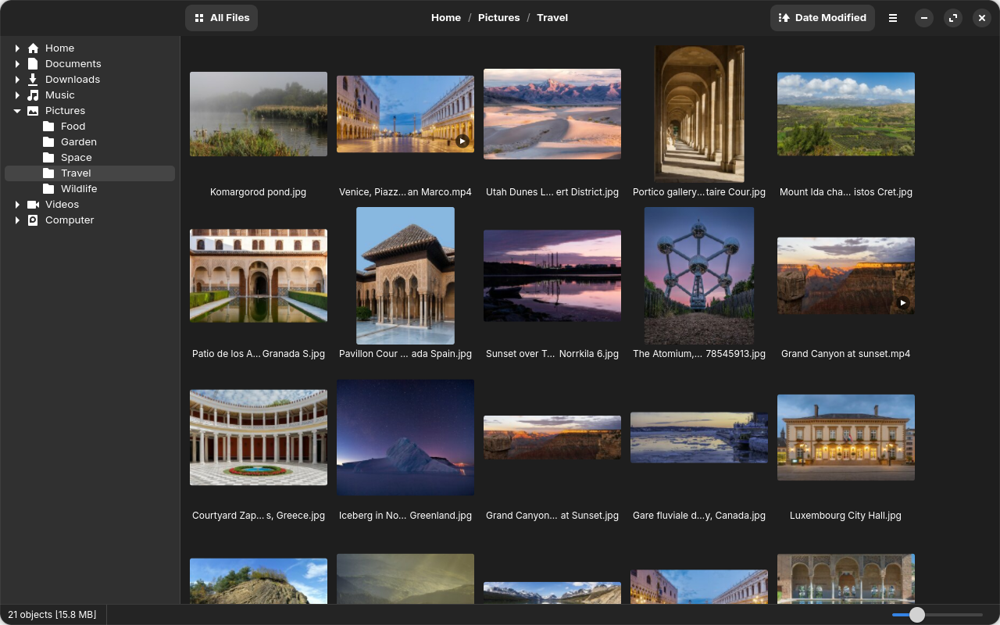

# FastViz

A minimal, very fast photo and video browser for Linux (GNOME, Wayland).

FastViz opens large folders of photos and clips instantly, even on slow or
external drives, and keeps a thumbnail cache so folders you have visited
before show up at once. It aims for the speed of FastStone Image Viewer with
a simple, modern GTK 4 look.



## Features

- Folder tree and a thumbnail grid that stays smooth with tens of thousands of files
- Home folders, every drive and your phone in the folder tree; drives mount when you open them
- Persistent thumbnail cache; JPEGs use their embedded or scaled-down previews
- Fullscreen viewer: shrink-to-fit, zoom and pan, next and previous items preloaded
- Video playback with hardware decoding (VA-API), and video thumbnails
- Photos: JPEG, PNG, WebP, GIF (animated), BMP, TIFF, HEIC/HEIF, AVIF
- Videos: MP4, MOV, MKV, WebM, AVI, WMV, FLV, MPEG, TS/M2TS, OGV, 3GP and more
- Sort by name, date modified, date taken, format, dimensions or size; shuffle
- Show all files, or only pictures, only videos, or both
- Cut, copy, paste, rename and move to Trash with undo, working with Files
- Slideshows

## Install

Both packages are on the
[Releases](https://github.com/WastedLookz/FastViz/releases) page.

**Flatpak** (most distributions): download `fastviz_0.1.1_x86_64.flatpak` and
open it in Software, or install it from a terminal:

```sh
flatpak install --user ./fastviz_0.1.1_x86_64.flatpak
```

It needs [Flathub](https://flathub.org/setup) set up, for the GNOME runtime it
runs on. FastViz itself is not on Flathub, so it doesn't update on its own:
install the next release's file the same way.

**Debian package** for **Ubuntu 24.04** and distributions based on it (Zorin
OS 18, Linux Mint 22, Pop!_OS 24.04), using the system's GTK, mpv and FFmpeg:
download `fastviz_0.1.1-1_amd64.deb` and open it, or:

```sh
sudo apt install ./fastviz_0.1.1-1_amd64.deb
```

## Build from source

Install Rust (<https://rustup.rs>) and the development packages:

```sh
sudo apt install build-essential pkg-config clang libclang-dev \
    libgtk-4-dev libadwaita-1-dev libmpv-dev libheif-dev libturbojpeg0-dev libegl-dev \
    libavcodec-dev libavformat-dev libavutil-dev libswscale-dev libswresample-dev \
    libavfilter-dev libavdevice-dev
```

Then build and run:

```sh
cargo build --release
./target/release/fastviz [file or folder]
```

`scripts/install-desktop.sh` adds a launcher for this build to your desktop
(and lists FastViz under "Open With"); `scripts/build-deb.sh` builds the `.deb`.

### Flatpak

`flatpak/` holds the Flatpak manifest (GNOME 51 runtime; it builds mpv and
libheif too). With the Flatpak builder from Flathub
(`flatpak install flathub org.flatpak.Builder`), `scripts/build-flatpak.sh`
builds the `.flatpak` file, or install straight from the checkout:

```sh
flatpak run org.flatpak.Builder --user --install --install-deps-from=flathub \
    --force-clean target/flatpak flatpak/io.github.wastedlookz.FastViz.yml
```

## Keys

**Thumbnails**

| Key | Action |
| --- | --- |
| Enter, double-click | Open folder, view photo or video fullscreen |
| Backspace, Alt+Up | Parent folder |
| Ctrl+mouse wheel | Thumbnail size |
| Ctrl+X, Ctrl+C, Ctrl+V | Cut, copy, paste (in the folder tree: the selected folder) |
| F2 | Rename |
| Delete, Shift+Delete | Move to Trash, delete permanently |
| F5 | Slideshow |
| F9 | Show or hide the folder tree |
| Ctrl+H | Show hidden folders |
| Ctrl+, | Preferences |

**Fullscreen**

| Key | Action |
| --- | --- |
| Mouse wheel, Left/Right, Page Up/Down | Previous, next |
| Home, End | First, last |
| Up, Down | Zoom in, out (videos: volume) |
| Click | 100% or fit (videos: pause) |
| 0 | Fit to the screen |
| Space | Pause a video or the slideshow |
| M | Mute |
| B | Gray or black background |
| I | Info overlay |
| Delete | Move to Trash and show the next |
| Esc, double-click | Back to the thumbnails |

Settings are kept in `~/.config/photoviewer/` and the thumbnail cache in
`~/.cache/photoviewer/`.

## License

FastViz is free software: you can redistribute it and/or modify it under the
terms of the GNU General Public License, version 3 or (at your option) any
later version. See [LICENSE](LICENSE).

It uses GTK, libadwaita, mpv, FFmpeg, libheif and libjpeg-turbo from the
system, and the Rust crates listed in `Cargo.lock`; the `.deb` includes their
license notices in `/usr/share/doc/fastviz/THIRD-PARTY-LICENSES.txt`.
